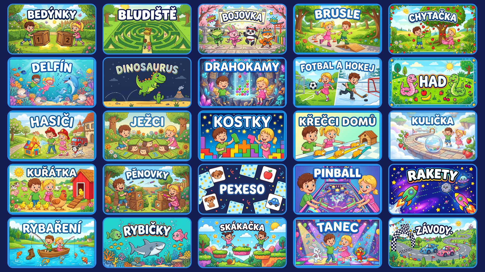
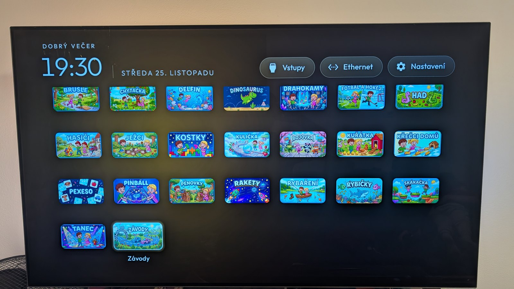
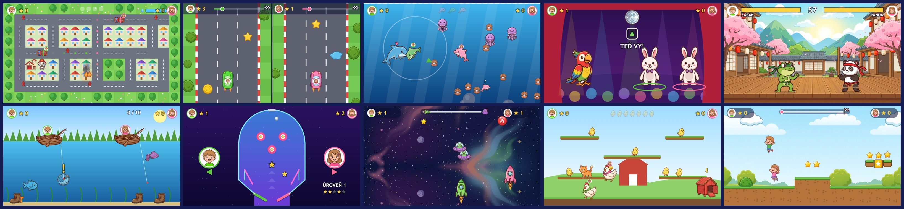

# TV minihry - 25 dětských her do Android TV

Hry, které jsme postavili pro naše dva prcky (Matyho a Nelu) a hrajeme je na televizi s gamepady.
Žánry, co jsme v devadesátých letech hrávali na konzolích, jen v dětské verzi. **V žádné hře se nedá prohrát
ani zaseknout:** pád znamená návrat na vlaječku, zásah jen chvilku zamotá a po pár neúspěších přijde nápověda.







- **25 her:** Pexeso (anglická slovíčka), Dinosaurus, Závody, Skákačka, Rakety, Had, Bojovka, Rybičky, Bedýnky,
  Bludiště, Chytačka, Hasiči, Fotbal a hokej, Brusle, Pěnovky, Kostky, Ježci, Drahokamy, Křečci domů, Kulička,
  Pinball, Delfín, Kuřátka, Tanec, Rybaření.
- **Režimy pro každého hráče zvlášť a Spolu:** dva gamepady a každé dítě ovládá svou postavu.
- **Mluví česky:** hlášky jsou předem nahrané, aby hra mluvila hned, a Google TTS slouží jako záloha.
- **Offline, bez reklam, bez sledování.** Aplikace nemá oprávnění k internetu.
- Každá hra má vlastní dlaždici na domovské obrazovce TV. Jde o jednu aplikaci, ve které jsou hry HTML/JS ve WebView.

## Jak to vzniklo

- Kód kompletně napsal **[Claude Code](https://claude.com/claude-code)**.
- Obrázky (postavičky, pozadí, dlaždice) vygeneroval **Higgsfield (Nano Banana Pro)** a skripty
  v `tools/*_sprites.py` je nařezaly na sprity.
- Na domovské obrazovce běží **[CleanYourTV](https://github.com/Gathin23/cleanyourtv)**, čistý launcher bez reklam
  pro Android TV a Google TV. Doporučujeme ho i bez her.
- Gamepady máme **8BitDo Zero 2**: dva malé, jeden zelený a jeden růžový.

## Jak si to dát na vlastní TV

Nejjednodušší cesta je dát úkol svému coding agentovi (Claude Code, Codex...):

> Naklonuj https://github.com/beeai-cz/tv-minihry. Přejmenuj hráče Maty a Nela na `<jméno 1>` a `<jméno 2>`
> (pozor na 5. pád v oslovení), vyměň avatary, sestav APK a nainstaluj ho na moji Android TV na `<IP adresa TV>`.

Ručně:

1. Na TV zapni Možnosti pro vývojáře (7x klikni na číslo sestavení) a v nich **Ladění USB** nebo síťové ladění.
2. Sestav APK. Potřebuješ JDK 17 a Android SDK 34 (nebo Android Studio):
   ```
   ./gradlew assembleRelease
   ```
3. Nainstaluj ho:
   ```
   adb connect <ip tv>
   adb install -r app/build/outputs/apk/release/app-release.apk
   ```
4. Ladění na TV potom zase vypni.

APK se podepisuje tvým debug klíčem (`~/.android/debug.keystore`). Ten si zálohuj. S jiným klíčem
novou verzi přes starou nenainstaluješ a po odinstalaci děti přijdou o postup (hvězdičky, úrovně).

## Přizpůsobení pro vaše děti

- **Jména a barvy hráčů:** `TV.PLAYERS` v `app/src/main/assets/common/tv.js` (`name`, `voc` = oslovení v 5. pádě).
- **Avatary:** `app/src/main/assets/common/img/avatar-*.png`.
- **Hlášky se jmény:** jsou v `tools/voice_phrases.py` a nahrané v `assets/common/voice/*.ogg`. Po změně jmen
  přepiš věty, nahraj je znovu (postup níž) nebo nahrané soubory se jmény smaž a hra je řekne přes Google TTS.
- **Nové obrázky:** prompty jsou v `art/prompts-sega.md`, řezání v `tools/sega_sprites.py`.

## Gamepady 8BitDo Zero 2

- Párovat v **režimu Android: B + START**. Bez toho se ovladač hlásí jako „Pro Controller“ (režim Switch)
  a párování s TV selže.
- Potom SELECT podržet 3 s, až rychle bliká, a na TV Nastavení > Dálkové ovladače a příslušenství > Přidat.
- Ve hrách: **A** = OK, **B** = akce (skok, střela, hašení), **Select** = zpět do menu, šipky = pohyb.

## Vývoj

Náhled v prohlížeči: `python -m http.server 8765 --directory app/src/main/assets` a pak http://localhost:8765/
(rozcestník všech her). Klávesnice: šipky + Enter (A) + X (B) = ovladač 1, WASD + F (A) + G (B) = ovladač 2,
Esc = zpět.

Zkouška bez prohlížeče (výjimky, zacyklení, průchod do konce): `node tools/headless.js <hra> <maty|nela|spolu>
[sekund] [tools/bots/<hra>.js]`. Bez robota hra náhodně mačká klávesy, s robotem se dohraje. Variantu vybírá `VAR=1`.

- `assets/common/tv.js` - scéna 1920x1080, ovládání (ovladač, gamepady, klávesnice), hlas, zvuky, konfety
- `assets/common/kit.js` - společná kostra novějších her (menu, párování ovladačů, odpočet, oslava, varianty)
- `assets/<hra>/` - jednotlivé hry
- `tools/add_games.py` zapojí novou hru do aplikace (dlaždice v manifestu, název, odkaz v rozcestníku)
- `docs/sega-hry.md` - zadání a pravidla novějších her

**Nahrání hlášek:** doplň větu do `tools/voice_phrases.py`, spusť `python tools/voice_phrases.py`, sestav a nainstaluj.
Pak `adb shell am start -n cz.beeai.tvhry/.Pexeso --ez export_voice true` (TV vysloví všechno do WAV), stáhni
`/sdcard/Android/data/cz.beeai.tvhry/files/voice` do `art/raw/voice` a spusť `python tools/voice_build.py`.

## Licence

Kód je pod MIT licencí (viz `LICENSE`). Obrázky a nahrané hlášky můžete pro své děti používat a upravovat
za stejných podmínek. Hry se inspirují žánry 90. let, postavy, názvy i vzhled jsou ale vlastní a projekt
nemá nic společného s žádným výrobcem konzolí.

Postavili [BeeAI](https://beeai.cz) a Claude pro Matyho a Nelu.
